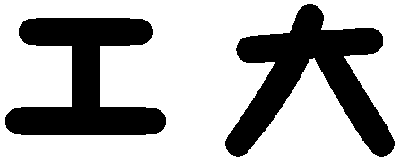

# 书法大咖 · 六轴机械臂写毛笔字

哈尔滨工业大学（深圳）机器人学课程设计。用 HL-0905 六轴机械臂夹持毛笔，在桌面上书写汉字
**"工大"**：自写字形库与笔画规划，按"提按"控制笔画粗细，经 Simscape Multibody 回代校验后导出
关节轨迹点位文件，可直接送控制器上机。



- 规划、验证、绘图全部在 MATLAB 中完成，**不依赖 Robotics Toolbox**（运动学沿用实验四的 POE 实现）
- 现有字形：`工`、`大`（简单笔画）；扩展方法见 [§9](#9-扩展与已知限制)
- 产物：`output/writing_joint.txt`（6 列关节角，deg）、墨迹预览、轨迹图、误差汇总
- **已上机验证（2026-11-23）**：实写照片 [`output/实际书写结果.jpg`](output/实际书写结果.jpg)；起点/终点都停在纸面中心上方 30 mm，首尾位形一致，可连续回放

## 1. 快速开始

### 1.1 前置条件

- MATLAB **R2026b**（含 Simulink、Simscape、Simscape Multibody）
- `Matlab/HL-0905/HL0905_2.slx` + 7 个关节 STL 网格（约 1.5 GB）。**本工作区已包含全部 8 个文件**
  （已从实验四目录复制：`J0..J6_默认_sldprt.STL` + `HL0905_2.slx` + `HL-0905.xml`）。
  STL 体积过大、未纳入 git，所以**从仓库全新克隆**时才需要手动复制
  `实验四/Matlab/HL-0905/*.STL` 到此目录；缺失时 `prepare_model` 加载模型会报装配失败。

### 1.2 运行

```matlab
% 完整流程：字形 -> 笔尖轨迹 -> 关节轨迹 -> Simscape 校验 -> 导出
addpath('Matlab'); run_design('工大')

% 只做规划与导出（秒级，改字库/参数时用；交付前必须跑完整流程）
run_design('工大', struct('simulate',false))

% 复跑已保存的轨迹并绘图（不重新规划）
simulate_design('writing')

% 在 Mechanics Explorer 里回放真实机械臂（需 MATLAB 桌面，不能 -batch）
play_writing
```

```bat
:: 无界面执行（回归首选）
D:\MATLAB\R2026b\bin\matlab.exe -batch "addpath('Matlab'); run_design('工大')"
```

完整流程约 **2–4 分钟**：逐点 IK 约 30 s（3.6 万点）、Simscape 回代仿真约 5 s，其余是 1.5 GB 模型加载与绘图。

### 1.3 看结果

| 文件 | 用途 |
| --- | --- |
| `output/writing_preview.png` | 墨迹预览（按深度渲染笔迹宽度），检查字形与粗细。按球头模型渲染，是**粗细上限**；实际墨宽约 3 mm，见 §4.2 |
| `output/writing_path.png` | 六联图：笔尖俯视/3D 轨迹、关节角、关节速度、关节加速度、提按与速度 |
| `output/writing_joint.txt` | 上机点位文件：6 列关节角（deg），无表头 |
| `output/design_summary.json` | 参数与仿真误差汇总 |

## 2. 目录结构

```text
course_design/
├── sim_writing.m              # 一键脚本（顶部 doPlay 控制跑完是否回放）
├── Matlab/
│   ├── BrushConfig.m          # 纯参数表（触纸关节角/笔长/待机高度/压深/速度/字格/容差）
│   ├── NormalizeConfig.m      # mm/deg -> SI，并由法兰接触点反推纸面与 Rtool
│   ├── CharLib.m              # 字形库：笔画几何 + 笔迹宽度曲线
│   ├── BrushPlanner.m         # 笔画 -> 笔尖轨迹（抬笔/空行程/落笔/绘制/提笔 + 提按）
│   ├── WriteTrajectory.m      # 笔尖轨迹 -> 关节轨迹（逐点 IK + 雅可比反解 qd/qdd）
│   ├── render_writing.m       # 由压入深度渲染墨迹位图
│   ├── plot_writing.m         # 墨迹预览 + 六联图（白底，可直接进报告）
│   ├── play_writing.m         # 在 Mechanics Explorer 里回放真实机械臂
│   ├── run_design.m           # 主流程 + 验收断言 + 导出
│   ├── simulate_design.m      # 复跑轨迹并绘图
│   ├── prepare_model.m        # 由原始模型生成可注入轨迹的 output/HL0905_2_writing.slx
│   ├── HL0905Config.m         # Xi/g0/qlim（由模型几何提取，勿手改）
│   ├── Fkine.m / POE.m        # POE 正运动学 + 雅可比
│   ├── Ikine6s.m              # 阻尼最小二乘连续解 IK（种子接力）
│   ├── MotionPlanning.m       # 同步归一化梯形速度规划（多轴共用一条 s(t)）
│   ├── TrajGena.m             # 归一化曲线 -> 关节 q/qd/qdd
│   ├── probe_model.m          # 生成 output/probes.mat（标定探针）
│   └── HL-0905/               # 原始 Simscape 模型 + STL（约 1.5 GB）
├── output/                    # 全部生成物（勿手改）；含上机实拍 实际书写结果.jpg
└── docs/
    ├── requirements.md        # 课设要求摘要与映射
    ├── 课设要求.pdf            # 原始要求（9 页）
    └── 实验四指导书.pdf        # 运动学/规划推导来源
```

## 3. 流水线

```text
CharLib          字形 -> 笔画（字格系 uv + 宽度曲线 + 逐笔速度）
   │
BrushPlanner     笔画 -> 笔尖世界轨迹
   │ 抬笔(竖直) / 空行程(水平, 80 mm/s) / 落笔(竖直, 12 mm/s) / 绘制(逐笔速度)
   │ 每段用 MotionPlanning 做梯形规划，段首段尾速度为 0
   │ 压入深度 d = w²/(8R)，实际 z = paperZ - pressOffset - d
   │ 末尾追加"回待机"段（笔尖回到纸面中心上方 standby）
   ▼
WriteTrajectory  笔尖轨迹 -> 关节轨迹
   │ IK 目标：法兰位姿 Tf = [Rtool, tip - L*Rz]；逐点以上一点为种子
   │ 关节速度：Jtip = [Jv - skew(raz)*Jw; Jw]，qd = Jtip \ [v;0;0;0]
   ▼
precheck         有限/单调/qlim/|qd|/|qdd| 断言
   ▼
prepare_model    修补原始模型：J1 允许外部 qd/qdd、To Workspace 改 Timeseries
   ▼
sim(in)          Simscape Multibody 回代（ode15s, MaxStep 1 ms）
   │ 位置误差 vs POE、姿态误差、笔尖路径偏差
   ▼
导出             writing_joint.txt / csv / png / design_summary.json / InitFcn 回写
```

## 4. 关键实现

### 4.1 末端位姿：书写姿态由触纸关节角实测确定

`qTouch_deg` 非空时（推荐），`run_design` 用 FK 取触纸位形的法兰姿态作为 `Rtool`：

```matlab
Tt   = Fkine(c.Xi, qTouch, c.g0);                                  % 触纸位形的法兰位姿
cfg.Rtool   = Tt(1:3,1:3);                                         % 实测书写姿态
cfg.paper_mm = (1000*Tt(1:3,4))' + cfg.brushLength_mm*cfg.Rtool(:,3)';   % 纸面 = 法兰 - L*笔轴
```

当前实测姿态（笔杆偏离竖直 0.92°，中锋几乎垂直）：

```text
Rtool = [-0.9824  0.1863  0.0145
          0.1862  0.9825 -0.0071
         -0.0155 -0.0043 -0.9999]
```

- `Rtool(:,3) ≈ [0.014 -0.007 -1]`：笔尖在法兰的 -Z 方向、`L = 220 mm`（2026-11-23 实测），**IK 目标 = 笔尖位置 - L*Rz**
- 姿态**全程固定**（不做腕部转动），整条轨迹只有一个 `Rtool`；用旧公式（`yaw=0`）从触纸种子做 IK 会直接 "Joint limit exceeded"
- 纸面反推写成 `(1000*Tt(1:3,4) + L*Rtool(:,3)')'` 会广播成 3×3、纸面全乱——**转置必须在加法之前**
- 只有 `qTouch_deg = []` 时才退回解析式 `Rtool = Rz(yaw)*diag([1 -1 -1])*rotx(tilt)`（`yaw`/`tilt` 字段），
  它假设法兰初始姿态恰为 `diag(1,-1,-1)`，与实机示教读数不符，仅供演示/回归

### 4.2 提按：深度与宽度的物理关系

把笔尖近似为半径 `R = 4 mm` 的球冠，压入深度 `d` 与接触圆半径 `a` 满足 `a = sqrt(2Rd)`。
字库里直接给"笔迹宽度" `w = 2a`，于是

```matlab
d = w^2 / (8 R)        % BrushPlanner.m，深度上限 maxPress = 1.5 mm
```

宽度最大 6.5 mm（撇）对应深度约 1.32 mm（上限 1.5 mm）；收笔处宽度收到 20–30 %，深度降到 ~0.1 mm，
于是"提笔"即抬 z。
这套模型让 `CharLib` 里的宽度曲线（起笔收窄、行笔饱满、收笔出锋）直接变成可见的粗细变化。

**实测修正（2026-11-23 上机）**：`pressOffset_mm=4` 时模型算出的接触宽 8.9–13 mm，纸面实际墨宽只有
竖笔 2.8 mm / 横笔 3.3 mm（按照片墨迹包围盒 162×56 mm 标定 ≈18 px/mm）。也就是说**球头模型在深压段高估 3–4 倍**：
软笔头是尖锋接触，压深越大只是把笔腰压弯，接触面并不按 `sqrt(d)` 扩张。`writing_preview.png` 的粗细是几何上限，
实际宽度基本由笔锋决定；真要加粗应换笔/加宽 `CharLib` 宽度表并降速让墨渗开，而不是继续加压。

### 4.3 速度与粗细

- 绘制速度：横 20 mm/s、竖 18 mm/s、撇捺 24 mm/s（`CharLib.m` 每笔的 `speed` 字段）
- 快慢影响"墨量"观感：慢笔更粗更黑，控制器/纸面不同需现场微调 `BrushConfig.speedDraw`
- 空行程 80 mm/s、落笔/抬笔 12 mm/s，均带梯形加减速（0.4 / 0.6 m/s²），避免起笔拖墨与抬笔甩墨

### 4.4 时间对齐（多轴同步）

所有轴共用同一条归一化梯形曲线 `s(t)`（`MotionPlanning.m`）：阶段时长按 `Ts` 向上取整后
重解峰值速度，保证 `s(end) = 1`。每个移动段一次规划，逐轴按 `q = q0 + s*Δq` 展开。
**不要各轴独立规划再缩放**——那样各轴到达时间不同，笔尖会画歪。

### 4.5 IK 连续性与关节速度

`Ikine6s` 用阻尼最小二乘（`dq = J'((JJ'+1e-10 I)\e)`，步长限幅 0.15 rad），必须以上一点解为种子：

```matlab
c.seed = seed; q(i,:) = Ikine6s(Tf, c); seed = q(i,:);   % WriteTrajectory.m
```

关节速度由**笔尖雅可比**反解（角速度约束为 0）：

```matlab
Jtip = [J(1:3,:) - skew(L*Rz)*J(4:6,:); J(4:6,:)];   % 6x6
qd   = Jtip \ [v; 0; 0; 0];
```

`qdd` 必须**按列（时间）逐列求导**：`for j=1:6, qdd(:,j)=gradient(qd(:,j),Ts); end`。
直接用 `gradient(qd,Ts)` 会沿"关节维"求差，得到上万 deg/s² 的假加速度。

### 4.6 墨迹预览

`render_writing.m` 把每个采样点按 `rw = sqrt(2R d)` 画成圆盘叠加成位图，再反色保存。
它不模拟真实墨扩散，但足以在不开仿真时快速判断字形、粗细与相对位置。

### 4.7 机械臂运动回放（Mechanics Explorer）

和实验四的码垛仿真一样，直接用模型里的 **HL-0905 实体模型**（Simscape Multibody）回放，
不需要另画示意几何：

```matlab
run_design('工大')                    % 先跑出轨迹（output/writing_simulation.mat）
play_writing                          % 打开 Mechanics Explorer 并回放

play_writing('gongda')                % 指定 tag
simulate_design('writing',true,true)  % 复跑 + 六联图 + 回放
run_design('工大',struct('play',true))% 规划+校验+回放，一条命令走完
```

`play_writing` 做的事：`prepare_model(cfg,true)` 打开 `SimMechanicsOpenEditorOnUpdate`，
把已验证的 `t/q/qd/qdd` 注入模型，按 `p.t(end)` 设 StopTime 后 `sim`。
仿真比实时快（约 5 s 跑完 36 s 轨迹），跑完后在 Mechanics Explorer 里按 **▶** 可 1 倍速重播，
时间轴能拖拽、可调速。

两个注意点：

- **Mechanics Explorer 只在 MATLAB 桌面里可见**，`-batch` 下不会弹窗（仿真照常通过，可用于回归）。
- 模型里的 7 个 `Solid` 几何原本只写了裸文件名（`J0_默认_sldprt.STL`），模型另存到 `output/`
  后按模型目录找不到 STL，实体会显示不出来。`prepare_model` 会把 `ExtGeomFileName` 改写成
  `Matlab/HL-0905/` 下的绝对路径（只影响显示，不影响动力学），所以工作区搬家后重跑一次
  `prepare_model` 即可恢复。

## 5. 参数表（`Matlab/BrushConfig.m`）

`BrushConfig.m` 里只有**要填的数字**，全部按示教器/尺子读数量取，不需要换算：

1. **`qTouch_deg`**（推荐）：笔尖刚触纸时抄下**六个关节角**（示教器 J1…J6，deg）。程序用 FK 直接反推法兰位置、书写姿态和纸面中心，不必再假设笔杆竖直；
2. **`flangeContact_mm`**（备选）：读不到关节角时，把笔尖移到纸面中心轻触纸面，抄下此时**法兰中心**坐标（mm）；
3. **`brushLength_mm`**：量法兰中心到笔尖的距离（mm）。

两者都按 `tip = flange + L·Rtool(:,3)` 反推纸面，所以**不用另外填纸面高度**。
当前标定（2026-11-23 上机）：触纸关节角 `[8.000 11.410 113.135 -0.634 54.693 199.099]°` → 法兰 `(456.42, 63.38, 592.94) mm`
（与示教器读数完全吻合，差 < 3 µm）、笔杆偏离竖直 0.92°、纸面中心 `(459.6, 61.8, 373.0) mm`。

| 字段 | 默认 | 含义 |
| --- | --- | --- |
| `qTouch_deg` | `[8.000 11.410 113.135 -0.634 54.693 199.099]` | **笔尖刚触纸时的关节角**（deg）：填了就用它的 FK 定书写姿态与纸面，优先于 `flangeContact_mm`；置 `[]` 关闭 |
| `flangeContact_mm` | `[456.418 63.377 592.944]` mm | 笔尖接触纸面中心时的法兰中心坐标（示教器读数）；仅在 `qTouch_deg=[]` 时生效 |
| `brushLength_mm` | 220 mm | 笔尖到法兰中心的距离；换夹具必须重测 |
| `brushRadius_mm` | 4 mm | 笔头等效球半径，决定 `d = w²/(8R)` 的比例 |
| `maxPress_mm` | 1.5 mm | 最大压入深度，防止压弯笔杆/戳破纸 |
| `lift_mm` | 10 mm | 抬笔高度（相对纸面） |
| `standby_mm` | 30 mm | 待机高度：笔尖停在**纸面中心正上方 30 mm**，起始与结束都停这里（文件首尾位形一致，可连续回放） |
| `pressOffset_mm` | 4 mm | 书写整体额外压深，叠加在提按深度上；墨色太淡加大、太重减小 |
| `yaw_deg`, `tilt_deg` | 0, 0 | 笔杆绕 Z 转角、相对竖直倾角（0=中锋垂直运笔） |
| `speedDraw_mm_s` | 20 mm/s | 常规绘制速度（越快越细越淡） |
| `speedPress_mm_s` | 12 mm/s | 落笔/提笔的竖直速度 |
| `speedMove_mm_s` | 80 mm/s | 空行程速度 |
| `accDraw_mm_s2` / `accMove_mm_s2` | 400 / 600 mm/s² | 绘制段 / 空行程加速度 |
| `cell_mm`, `cellGap_mm` | 80, 20 mm | 字格边长与字距，"工大"总宽 180 mm |
| `Ts_s` | 0.001 s | 采样周期（点位文件的时间粒度） |
| `q0_deg` | `[8.000 11.410 113.135 -0.634 54.693 199.099]°` | **备选**：仅在 `qTouch_deg=[]` 时直接作为起始位形。正常情况下起始位形由 `qTouch_deg` 反解到待机高度，无需手填 |
| `qdMax_rad_s`, `qddMax_rad_s2` | π/3（60 °/s）, π（180 °/s²） | 预检用的关节速度/加速度护栏。**为自定值，非厂家额定值**；实测书写 11.1 °/s、144.2 °/s²，约 5.4×/1.25× 余量。查到手册后建议取额定值的 60%~70% |
| `posTol_mm`, `oriTol_deg`, `pathTol_mm` | 0.01, 0.001, 0.01 | 仿真校验阈值（一般不动） |

单位换算在 `Matlab/NormalizeConfig.m`（`run_design`/`simulate_design` 开头调用）；纸面中心、书写姿态、待机起始位形
由 `run_design` 用 `qTouch_deg` 的 FK 一次反推（见 §4.1），`BrushConfig.m` 本身保持"纯参数表"。运行时会打印两行供现场核对：

```text
示教触纸姿态：法兰 (456.4, 63.4, 592.9) mm，笔杆偏离竖直 0.92 deg
待机起始位形 (deg): [8.000 9.192 111.293 -0.605 58.753 199.046]
法兰接触坐标 (456.4, 63.4, 592.9) mm，笔长 L=220 mm，字格 80 mm
=> 纸面（笔尖）中心 (459.6, 61.8, 373.0) mm，抬笔高度 10 mm
```

## 6. 输出文件（`output/`）

| 文件 | 内容 |
| --- | --- |
| `writing_joint.txt` | **上机点位文件**：N×6 关节角（deg），`%.9f`，无表头/时间列 |
| `writing_timeline.csv` | 时间序列：t, q, qd, qdd（rad） |
| `writing_tip_path.csv` | 笔尖世界轨迹（mm）+ 压入深度、速度、段名 |
| `writing_simulation.mat` | `p`（关节轨迹）、`plan`（笔尖计划）、`metric`（误差） |
| `writing_preview.png` | 墨迹预览 |
| `writing_path.png` | 六联图：俯视/3D/关节角/关节速度/关节加速度/提按与速度 |
| `design_summary.json` | 参数、笔尖范围、误差指标、文件索引 |
| `实际书写结果.jpg` | 上机实拍（2026-11-23 存档，非程序生成） |
| `model_workspace.mat` | `t,q,qd,qdd`，供模型 InitFcn 加载 |
| `HL0905_2_writing.slx` | 修补后的模型，InitFcn 已指向 `model_workspace.mat` |
| `design.log` | 运行日志（追加写；可随时清空，不影响产物） |

## 7. 上机流程（2026-11-23 已实跑通过）

**只需改 `BrushConfig.m` 里的两个数**（都按示教器/尺子读数，见 §5）：

```matlab
cfg.qTouch_deg=[8.000 11.410 113.135 -0.634 54.693 199.099];  % 笔尖刚触纸时的六个关节角（deg）
cfg.brushLength_mm=220;                                       % 法兰中心到笔尖（尺子量，mm）
```

0. **先把机器人 jog 到程序打印的「待机起始位形」**（当前 `[8.000 9.192 111.293 -0.605 58.753 199.046]°`，笔尖在纸面中心正上方 30 mm）。
   首行、末行都是这个位形；现场位形不一致控制器会报 "The joint distance of Current location and PPB start location are too far away"。

1. **对刀（必做）**：笔尖轻触纸面 → 抄下**六个关节角** → `qTouch_deg`（姿态、纸面中心、待机起始位形全由它自动反解，无需手填 `q0_deg`/`paperZ`）；
   量法兰到笔尖距离 → `brushLength_mm`。只能读到法兰坐标时退回填 `flangeContact_mm`。纸面高度差 1 mm 就会压不实或戳纸。
2. **空跑**：把 `standby_mm` 临时加到 60 跑一遍，确认轨迹无碰撞、无奇异。
3. **慢速试写**：`speedDraw_mm_s` 降到 10、`pressOffset_mm` 降到 2，试写单笔，看墨迹宽度。
4. **正式书写**：恢复参数跑 `run_design('工大')`，按控制器要求加载 `output/writing_joint.txt`
   （6 列 deg，逐点位置指令；若控制器要求速度，用 `writing_timeline.csv`）。跑完自动抬回待机位。
5. **收尾**：提笔离开纸面、清洁笔尖；把 `design_summary.json` 与实拍照片（如 `output/实际书写结果.jpg`）存档，供汇报使用。

> 安全：首次上机务必把示教器速度倍率降到 10 %，手放急停；笔尖接触纸面前不要开启连续执行。

## 8. 验证与指标

`run_design` 在导出前强制三条断言（阈值见 §5）：

| 指标 | 含义 | 实测（当前产物，36163 点 / 36.16 s） |
| --- | --- | --- |
| `max_position_error_mm` | Simscape 末端位置 vs POE 复算 | 3.26e-12 mm |
| `max_orientation_error_deg` | 姿态偏差 | 1.03e-13 ° |
| `max_path_error_mm` | 笔尖轨迹 vs 规划路径 | 2.00e-8 mm |
| `max_speed_deg_s` / `max_acceleration_deg_s2` | 关节速度/加速度峰值 | 11.06 °/s / 144.19 °/s²（限值 60 / 180） |

另有一条几何标定断言（`run_exp4` 遗留）：POE 与模型探针 `output/probes.mat` 的最大偏差 < 1e-8
（当前 8.55e-15）。**换机器人/改模型后必须重新标定**，方法见 `docs/实验四指导书.pdf` §3。

### 上机实测（2026-11-23）

| 项目 | 结果 |
| --- | --- |
| 轨迹 | 36163 点 / 36.16 s；首行 = 末行 = 待机位形，可连续回放 |
| 待机位 | 笔尖在纸面中心正上方 30 mm，`[8.000 9.192 111.293 -0.605 58.753 199.046]°` |
| 压深 | 提按 0–1.32 mm + `pressOffset_mm` 4 mm → 最大 5.32 mm |
| 实测墨宽 | 竖笔 2.8 mm、横笔 3.3 mm（模型预测 8.9–13 mm，见 §4.2 实测修正） |
| 结果 | [`output/实际书写结果.jpg`](output/实际书写结果.jpg)：字形"工大"完整、笔画无断裂、提按可见；"工"左上与"大"右横起笔处有轻微积墨点（落笔停顿所致） |

## 9. 扩展与已知限制

### 新增字形

1. 在 `Matlab/CharLib.m` 的 `switch` 中加一个 `case`，用 `line2`（直线）或 `bez2`（二次贝塞尔）描述笔画；
2. 宽度用节点表 `[t0 w0; t1 w1; ...]`（归一化弧长 -> 宽度比例），撇捺用 4–5 个节点做提按；
3. 每笔可单独给 `speed`（mm/s）；
4. 运行 `run_design('新字', struct('simulate',false))`，先看 `writing_preview.png` 调形，再跑完整流程。

字格坐标系：原点在字格中心，u 向右、v 向上，单位为米；笔画按弧长 0.5 mm 重采样。

### 已知限制

- 只在**平面**上书写（纸面水平）；无曲面/自适应高度
- 只有开环位置控制，**无力控/接触力反馈**，纸面不平靠 `maxPress` 留余量
- 字库仅 `工`、`大`，笔画是单线 + 宽度曲线，不是真正的楷书轮廓填充
- 未考虑墨水扩散、笔毛分叉、纸张吸墨等物理过程；起笔/收笔有轻微积墨点（落笔停顿处）
- **球头接触模型在深压段高估 3–4 倍**（实测墨宽 ~3 mm vs 模型 9–13 mm）：软笔头是尖锋接触，压深主要压弯笔腰，不按 `sqrt(d)` 扩张；预览图的粗细只能当上限看，见 §4.2
- 实体回放（`play_writing`）依赖 MATLAB 桌面；`-batch` 下只做数值校验，不弹 Mechanics Explorer
- `output/HL0905_2_writing.slx` 是构建产物：每次 `run_design` 都从
  `Matlab/HL-0905/HL0905_2.slx` 重新生成，不要手工改它

### 后续可做

- 楷书困难任务（`永`）：需要更细的提按节点、转折处圆角、笔画间的"笔断意连"
- 用 `char` 轮廓（如矢量字体）自动生成笔画中线 + 宽度，替代手写字库
- 加力传感器做恒力控制，纸面不平也能保持墨宽一致
- 多字排版（横向/纵向）、落款与印章

## 10. 相关文档

- [`docs/requirements.md`](docs/requirements.md)：课设要求摘要与实现映射
- [`AGENTS.md`](AGENTS.md)：给 AI 代理/自动化脚本的协作约定（模块职责、不变量、陷阱）
- [`docs/实验四指导书.pdf`](docs/实验四指导书.pdf)：POE 运动学、梯形规划、Simscape 建模范例
- 运动学标定与模型修补细节：`Matlab/HL0905Config.m`、`Matlab/prepare_model.m`、`Matlab/probe_model.m`
